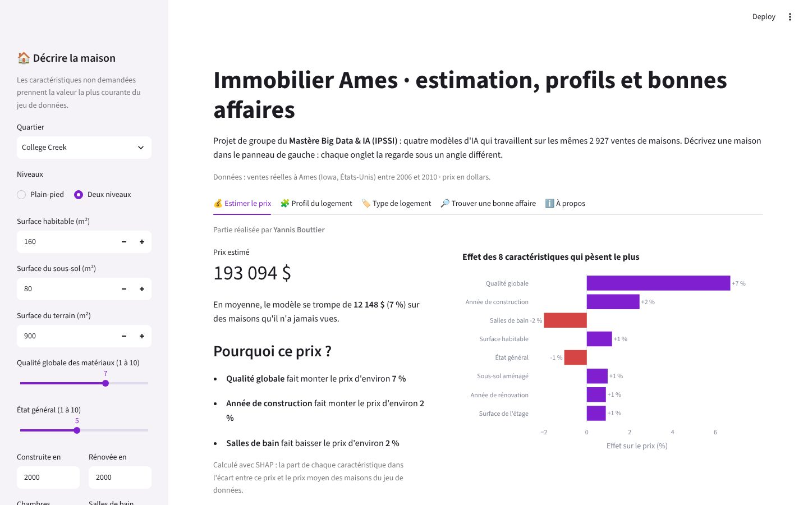
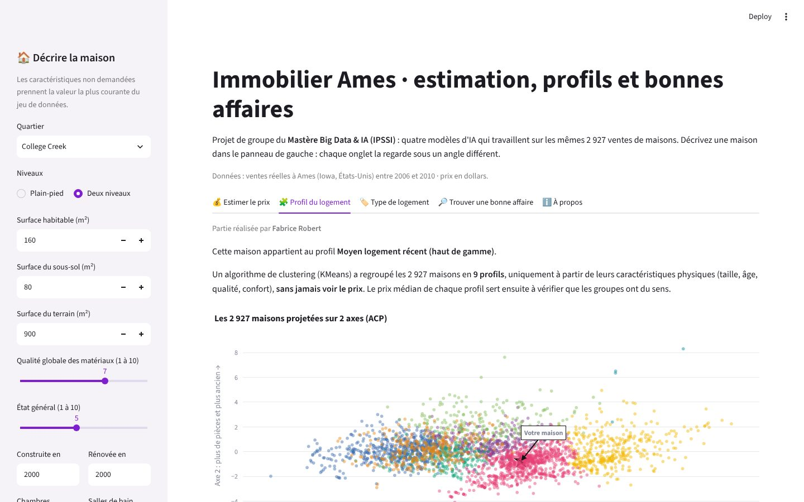
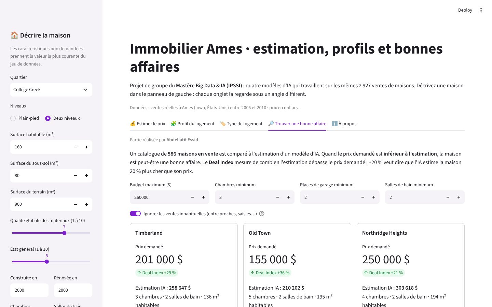

# Immobilier Ames · estimation, profils et bonnes affaires

Projet de groupe du **Mastère Big Data & IA (IPSSI)** : un POC (preuve de concept) pour une agence immobilière, construit sur les ventes réelles de **2 927 maisons** à Ames (Iowa, États-Unis) entre 2006 et 2010. Quatre modèles d'IA regardent la même maison sous quatre angles, réunis dans une interface **Streamlit**.



## L'équipe

| Partie | Réalisée par | Méthode | Résultat sur des maisons jamais vues |
|---|---|---|---|
| Estimation du prix | **Yannis Bouttier** | XGBoost sur 93 caractéristiques, explications SHAP | **6,9 % d'erreur moyenne** (12 148 $), R² de 0,95 |
| Profils de logements | **Fabrice Robert** | Clustering KMeans à 9 profils, sans utiliser le prix | Profils cohérents avec le prix médian (113 000 $ → 302 000 $) |
| Type de logement | **Duncan Costes** | Régression logistique (3 modèles comparés) | **95,6 %** de bonnes réponses |
| Recommandation | **Abdellatif Essid** | XGBoost léger + Deal Index | Top 3 des bonnes affaires selon le budget du client |

## Ce que fait l'application

1. **Estimer le prix** : on décrit une maison (quartier, surface, qualité, année…) et le modèle donne son prix, avec les caractéristiques qui le font monter ou baisser.
2. **Profil du logement** : la maison est placée parmi les 9 profils trouvés par le clustering (« Grand logement récent (haut de gamme) », « Petit logement ancien (entrée de gamme) »…).
3. **Type de logement** : un classifieur retrouve ce profil à partir de la fiche complète du bien et donne sa confiance.
4. **Trouver une bonne affaire** : dans un catalogue de 586 maisons, on filtre selon le budget et les critères du client, puis on classe les biens dont le prix est inférieur à l'estimation du modèle.

| Profils de logements | Recommandation |
|---|---|
|  |  |

## Lancer l'application

```bash
pip install -r requirements.txt
streamlit run app.py
```

Les modèles déjà entraînés sont dans `models/`. Pour les réentraîner à partir des données :

```bash
python src/train_all.py          # environ 4 minutes
python src/train_all.py --grid   # refait aussi la recherche d'hyperparamètres du prix (environ 5 minutes)
```

## Utiliser l'API d'estimation

La partie « prix » est aussi exposée sous forme d'API (FastAPI) : on envoie les caractéristiques d'une maison, on reçoit le prix estimé, la marge d'erreur habituelle du modèle et **les 3 raisons principales** de ce prix. L'application Streamlit et l'API partagent le même code (`src/estimation.py`).

```bash
pip install -r requirements-api.txt
uvicorn api:app --reload          # documentation interactive : http://localhost:8000/docs
```

```bash
curl -X POST http://localhost:8000/predict -H "Content-Type: application/json" \
  -d '{"quartier": "CollgCr", "niveaux": "deux niveaux", "surface_m2": 160, "qualite": 7, "annee_construction": 2000}'
```

Réponse (champs non précisés = valeurs par défaut, voir `/docs`) :

```json
{
  "prix_estime_usd": 193094,
  "erreur_moyenne_usd": 12148,
  "erreur_moyenne_pct": 6.9,
  "fourchette_usd": [180946, 205242],
  "trois_raisons": [
    {"facteur": "Qualité globale", "effet": "hausse", "effet_pct": 6.7},
    {"facteur": "Année de construction", "effet": "hausse", "effet_pct": 2.5},
    {"facteur": "Salles de bain", "effet": "baisse", "effet_pct": -2.0}
  ]
}
```

`GET /quartiers` liste les codes de quartier acceptés ; `GET /health` sert au contrôle de santé.

### Avec Docker

```bash
docker build -t prix-immobilier .
docker run -p 8000:8000 prix-immobilier      # ou : docker compose up --build
```

L'API est alors sur http://localhost:8000/docs.

## Structure du dépôt

```
app.py                      interface Streamlit (5 onglets)
api.py                      API FastAPI : prix + 3 raisons (POST /predict)
Dockerfile, docker-compose.yml   empaquetage de l'API
requirements-api.txt        dépendances de l'API (sans Streamlit)
src/estimation.py           estimation et explications, partagées par l'app et l'API
src/common.py               chargement, nettoyage et variables dérivées communs
src/train_prix.py           partie 1 : estimation du prix
src/train_clustering.py     partie 2 : profils de logements
src/train_type_logement.py  partie 3 : type de logement
src/train_recommandation.py partie 4 : recommandation
src/train_all.py            réentraîne les 4 modèles dans l'ordre
models/                     modèles entraînés et résultats (fichiers .json)
notebooks/                  notebooks d'origine de chaque membre de l'équipe
data/AmesHousing.csv        jeu de données
```

## Méthode en bref

- **Nettoyage commun** : retrait de 5 ventes atypiques recommandé par l'auteur du jeu de données ; les valeurs manquantes qui veulent dire « pas d'équipement » (pas de garage, pas de piscine…) sont codées comme telles ; ajout de variables dérivées (surface totale, âge, nombre de salles de bain…).
- **Prix** : le modèle apprend le logarithme du prix (les prix très élevés pèsent moins) ; 6 modèles comparés en validation croisée à 5 plis, de la moyenne à XGBoost ; évaluation finale en dollars sur 20 % des maisons mises de côté dès le départ.
- **Profils** : 12 caractéristiques physiques standardisées ; 9 groupes retenus pour être exploitables (le découpage mathématiquement optimal, à 2 groupes, est trop grossier).
- **Type de logement** : le numéro de groupe du clustering est retiré des variables pour éviter une fuite de données ; la catégorie à 4 maisons est écartée.
- **Recommandation** : filtres stricts du client, puis classement par qualité × 10 + Deal Index (de combien l'estimation dépasse le prix demandé).

## Adaptations par rapport aux notebooks d'origine

Les 4 parties ont été réécrites en scripts reproductibles à partir des notebooks de chacun (dossier `notebooks/`), avec ces ajustements :

- **Recommandation** : le notebook d'origine utilisait la version Kaggle du jeu de données (1 460 maisons). Ici, elle utilise le même jeu complet que les autres parties. Une option écarte aussi les ventes inhabituelles (entre proches, saisies…), dont le prix ne reflète pas le marché et produit de fausses bonnes affaires.
- **Explications du prix** : les contributions SHAP sont calculées par XGBoost lui-même, sur les données au même format qu'à l'entraînement, pour qu'elles correspondent exactement à la prédiction.
- **Hyperparamètres du prix** : avec les versions de `requirements.txt`, la recherche en grille retient 500 arbres (800 dans le notebook, avec des versions plus anciennes) ; les résultats restent équivalents.

## Données

Jeu de données *Ames Housing* : De Cock, D. (2011), « Ames, Iowa: Alternative to the Boston Housing Data as an End of Semester Regression Project », *Journal of Statistics Education*, 19(3). Les surfaces d'origine sont en pieds² (l'interface les saisit en m²) et les prix en dollars.

## Limites

- Une seule ville américaine, entre 2006 et 2010 : les modèles ne s'appliquent pas tels quels à un autre marché ou à une autre période.
- L'interface ne demande que les caractéristiques principales ; les autres prennent la valeur la plus courante du jeu de données.
- Un Deal Index élevé invite à examiner le bien de plus près ; ce n'est pas une garantie de bonne affaire.
